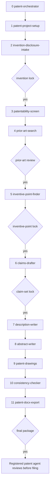

# patent-drafting-skills

An agent skill suite that helps a researcher or engineer turn a technical
idea into a filing-ready **invention patent** draft. It supports three
modes: a Chinese invention patent (发明专利), a US utility non-provisional,
and a PCT international application (国际申请).

The suite interviews you, screens subject matter, searches real prior art,
and locks the inventive points before anyone writes claims. Later skills
draft the claims, description, abstract, drawings, a consistency check, and
Word files. Nothing is filed for you.

Author: Xuzhen Li. License: MIT.

## Disclaimer

This is drafting assistance, not legal advice. It does not create a
patent-agent relationship. Have a 专利代理师 (registered patent agent) or
a patent attorney review the package before you file it. Office rules,
fees, and forms change. Confirm them on the official site.

Do not use the drafts to hide a publication or a close reference. A public
disclosure before filing can destroy novelty. In China, your own paper is
usually fatal: 专利法 Art. 24 is a narrow six-month exception, not a
general grace period. In the United States, 35 U.S.C. § 102(b)(1) is a
one-year inventor grace. A PCT filing does not invent a grace period.

## Who it is for

Researchers and engineers drafting a first invention patent, including
people who have a lab notebook and no claim-drafting habit. You stay the
inventor. The agent writes only what you confirm, and it marks gaps as
`【待发明人确认】` or `[INVENTOR TO CONFIRM]`.

It is a poor fit for design patents (外观设计), freedom-to-operate
opinions, litigation, and office-action responses. Those are outside this
suite. Utility models (实用新型) appear only as a recommendation inside
the Chinese screen, not as a separate drafting track.

## How a draft moves

You start at `patent-orchestrator`. It reads `patent.yaml` and sends you
to the first unfinished stage. After each stage, come back to the
orchestrator. Human gates stop the pipeline until you explicitly approve.



`patentability-screen` can stop the flow when the subject matter is
excluded. `patent-drawings` can be skipped only when you record
`drawings: none` because figures are not needed to understand the
invention. A unity split goes back to the inventive-point skill before
any single claim set is written. A sheet that fails the visual check or
the checksum goes back to `patent-drawings`. Export embeds those sheets
and stops if a checksum no longer matches.

## Skills

| # | Skill | What it does | Main output |
|---|-------|----------------|-------------|
| 0 | `patent-orchestrator` | Status, routing, gates, jurisdiction switch | Status report |
| 1 | `patent-project-setup` | Create the project tree and, when old drafts exist, copy them read-only and score the earliest real gap | `patent.yaml`, `incoming/`, `intake_score.json` |
| 2 | `invention-disclosure-intake` | Interview you; origin tag and evidence grade on each feature and effect; invention lock | `00-disclosure/disclosure.md`, `fact_ledger.md` |
| 3 | `patentability-screen` | Eligibility (CN Arts. 2, 5, 25; US § 101). CN: invention vs utility model | `01-eligibility/screen.md` |
| 4 | `prior-art-search` | Real database searches, feature matrix, and whether one document shows every essential feature | `02-prior-art/search_log.md`, `feature_matrix.csv` |
| 5 | `inventive-point-finder` | 三步法 or US § 103; unity on a special technical feature; unverified effects left out | `03-inventive-points/inventive_points.md` |
| 6 | `claims-drafter` | Dependency sketch before sentences; one invention or a documented combination; fee warning, no claim ceiling | `04-claims/claims.md` |
| 7 | `description-writer` | Description, domain checklist, background admission pass, added-matter list, biology reminders | `05-description/description.md` |
| 8 | `abstract-writer` | CN abstract ≤ 300 characters, or US abstract ≤ 150 words | `06-abstract/abstract.md` |
| 9 | `patent-drawings` | Frozen parts master, editable-source sheets, sha256 per sheet | `07-drawings/parts_master.json`, `sheet_manifest.json` |
| 10 | `consistency-checker` | Opens each sheet; black-on-white and which figure shows each relationship | `08-consistency/report.md` |
| 11 | `patent-docx-export` | Word files with the sheets embedded; export fails if a checksum changed | `09-package/*.docx` |

Skills 0–5 are the path from an idea to a locked inventive point. Skills
6–11 turn that lock into filing documents. The spec for the whole suite
is [docs/DESIGN.md](docs/DESIGN.md).

## Install

The script symlinks or copies each `skills/<name>` folder into the agent
skill directory under `$HOME`. Default mode is `link`. A second run of the
same command leaves a correct install unchanged. Link mode will not
overwrite a real directory that already sits at the destination.

| Target | Flag | Directory |
|--------|------|-----------|
| Cursor | `--target cursor` | `$HOME/.cursor/skills` |
| Claude Code | `--target claude` | `$HOME/.claude/skills` |
| Codex | `--target codex` | `$HOME/.codex/skills` |
| All three | `--target all` | the three paths above |

```bash
chmod +x install.sh
./install.sh --target cursor
./install.sh --target claude --mode copy
./install.sh --target all --dry-run
./install.sh -h
```

`--mode link` (default) creates a symlink. `--mode copy` copies files and,
on a later run, replaces that skill folder's contents. `--dry-run` prints
the actions and writes nothing.

Start a new agent session after installing so the new skills are picked
up. `shared/` stays in this repository; it is not copied into the agent
folder. Each skill's `SKILL.md` carries the procedure it needs.

## Quick start

Chinese invention patent:

```
我要写一个发明专利
```

The orchestrator routes to `patent-project-setup` with jurisdiction `CN`.
You get a Chinese 技术交底书 template. The agent then interviews you and
will not lock the invention until you say `发明人确认锁定交底`.

US utility draft:

```
start a US patent draft
```

Same path, jurisdiction `US`, English disclosure form, US eligibility
checklist, and an obviousness worksheet instead of a Chinese grant conclusion.

PCT:

```
起草一件PCT国际申请
```

English international draft. Say which national phases you care about
(China, the United States, or both). The agent will not assume a list.

Have a project path ready, for example a folder you created for this
invention. Do not paste unpublished numbers into a channel you do not
want to keep.

## Project layout

`patent-project-setup` creates this tree. Later skills write only to
their own folders.

```
<project>/
  patent.yaml
  00-disclosure/     disclosure form, then the filled disclosure
  01-eligibility/
  02-prior-art/
  03-inventive-points/
  04-claims/
  05-description/
  06-abstract/
  07-drawings/
  08-consistency/
  09-package/
  incoming/          read-only copies of old drafts, when any
  LOG.md
```

`patent.yaml` holds the title, jurisdiction, applicant, inventors, field,
disclosure flag, drawing flag, and the five gates. `LOG.md` is append-only.

## Jurisdiction modes

Set `jurisdiction` to `CN`, `US`, or `PCT`. Outputs follow that mode:
Chinese for `CN`, English for `US` and `PCT`. Switching later reopens
the gates. The agent does not translate a locked Chinese claim set into
a US claim set by itself.

| | CN | US | PCT |
|---|----|----|-----|
| What you are drafting | 发明专利 | Utility non-provisional | International application |
| Claims | Two-part form with 其特征在于 when it fits | "Comprising" claims; Jepson form is optional | Two-part form where appropriate (PCT Rule 6.3) |
| Description | 技术领域、背景技术、发明内容、附图说明、具体实施方式 | 37 CFR 1.77 sections | PCT Rule 5, including the best mode the inventor actually states |
| Abstract | ≤ 300 characters, punctuation included; one 摘要附图 | ≤ 150 words (37 CFR 1.72(b)) | Preferably 50–150 English words (PCT Rule 8) |
| Grace period | Art. 24, four cases, six months (2020): public-interest first disclosure during a national emergency or extraordinary situation; an international exhibition sponsored or recognized by the Chinese government; a prescribed academic or technological meeting; disclosure by another person without the applicant's consent | § 102(b)(1), one year, inventor-linked disclosures | None in the Treaty; national law applies later |

Document sets, drawing rules, and fee pointers:
[shared/jurisdictions.md](shared/jurisdictions.md).

Search only on official sites:
[CNIPA search](https://pss-system.cponline.cnipa.gov.cn),
[Google Patents](https://patents.google.com),
[Espacenet](https://worldwide.espacenet.com),
[The Lens](https://www.lens.org),
[PATENTSCOPE](https://patentscope.wipo.int),
[USPTO Patent Public Search](https://ppubs.uspto.gov).

Fees: [cnipa.gov.cn](https://www.cnipa.gov.cn),
[uspto.gov](https://www.uspto.gov),
[patentscope.wipo.int](https://patentscope.wipo.int).
The skills do not hard-code fee amounts.

## Principles

1. Never invent experimental data, effects, or embodiments. Unknowns stay marked.
2. Every claim feature must be supported by the description (专利法 Art. 26, paragraph 4; 35 U.S.C. § 112(a)).
3. Antecedent basis: 所述 / "the" / "said" needs an earlier 一种 / "a".
4. Reference signs in the description and the drawings match one-to-one. Formal sheets are PNG exports of an editable source, each with a sha256. Export embeds those bytes and stops if the hash changed.
5. Prior-art citations are real documents with publication numbers and links.
6. Ask about public disclosure before drafting. Grace periods are not interchangeable across CN, US, and PCT.
7. Human gates: invention lock, prior-art review, inventive-point lock, claim-set lock, final package. The agent cannot close a gate by itself. The final gate means the draft is internally complete. It still needs counsel before filing.

Gate phrases and reopen rules: [shared/gates.md](shared/gates.md).
Chinese–English terms: [shared/glossary_cn_en.md](shared/glossary_cn_en.md).

## Repository layout

```
patent-drafting-skills/
  README.md
  README.zh-CN.md
  LICENSE
  CHANGELOG.md
  install.sh
  docs/DESIGN.md
  shared/
    jurisdictions.md
    gates.md
    glossary_cn_en.md
  skills/
    patent-orchestrator/
    patent-project-setup/
    invention-disclosure-intake/
    patentability-screen/
    prior-art-search/
    inventive-point-finder/
    claims-drafter/
    description-writer/
    abstract-writer/
    patent-drawings/
    consistency-checker/
    patent-docx-export/
```

All twelve skills are in this tree. Each skill is a `SKILL.md` plus `references/`
or `scripts/` where that skill needs them. Instructions in `SKILL.md`
are English, with the Chinese legal term in parentheses the first time
it appears. Chinese templates are for `CN`. English templates are for
`US` and `PCT`.

## License

MIT. Copyright (c) 2026 Xuzhen Li. See [LICENSE](LICENSE).
History: [CHANGELOG.md](CHANGELOG.md).
