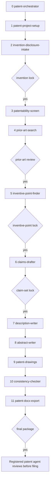

# patent-drafting-skills

Agent skills for drafting an English invention patent: a US utility
non-provisional or a PCT international application. You give the agent
your technical idea; it interviews you, screens subject matter, searches
real prior art, and locks the inventive points before any claim is
written. Later skills draft the claims, description, abstract, and
drawings, check them against each other, and export Word files. Nothing
is filed for you.

For a Chinese invention patent (CNIPA, written in Chinese), use
[patent-skills-private](https://github.com/Xuzhen-Li/patent-skills-private)
instead. This repository no longer has a Chinese mode.

Author: Xuzhen Li. License: MIT.

## Disclaimer

This is drafting help, not legal advice. It does not create a
patent-agent relationship. Have a registered patent agent or a patent
attorney review the package before you file it. Office rules, fees, and
forms change. Confirm them on the official site.

Do not use the drafts to hide a publication or a close reference. A
public disclosure before filing can destroy novelty. In the United
States, 35 U.S.C. § 102(b)(1) is a one-year inventor grace. A PCT filing
does not create a grace period, and some national phases (China, for
example) give no general grace for the inventor's own paper.

## Scope

For researchers and engineers drafting a first invention patent in
English, including people who have a lab notebook and no claim-drafting
habit. You stay the inventor. The agent writes only what you confirm and
marks gaps as `[INVENTOR TO CONFIRM]`. If your notes are in Chinese,
[shared/glossary_cn_en.md](shared/glossary_cn_en.md) lists the standard
English terms.

Not covered: design patents, plant patents, freedom-to-operate opinions,
litigation, and office-action responses.

## How a draft moves

You start at `patent-orchestrator`. It reads `patent.yaml` and sends you
to the first unfinished stage. After each stage, come back to the
orchestrator. Human gates stop the pipeline until you explicitly approve.



`patentability-screen` can stop the flow when the subject matter is
excluded. `patent-drawings` can be skipped only when you record
`drawings: none` because figures are not needed to understand the
invention. A unity split goes back to the inventive-point skill before
any single claim set is written. A sheet that fails the visual check or
the checksum goes back to `patent-drawings`. Export embeds those sheets
and stops if a checksum no longer matches.

## Skills

| # | Skill | What it does | Main output |
|---|-------|----------------|-------------|
| 0 | `patent-orchestrator` | Status, routing, gates, US/PCT switch | Status report |
| 1 | `patent-project-setup` | Create the project tree and, when old drafts exist, copy them read-only and score the earliest real gap | `patent.yaml`, `incoming/`, `intake_score.json` |
| 2 | `invention-disclosure-intake` | Interview you; origin tag and evidence grade on each feature and effect; invention lock | `00-disclosure/disclosure.md`, `fact_ledger.md` |
| 3 | `patentability-screen` | Eligibility (US § 101; PCT industrial applicability) | `01-eligibility/screen.md` |
| 4 | `prior-art-search` | Real database searches, feature matrix, and whether one document shows every essential feature | `02-prior-art/search_log.md`, `feature_matrix.csv` |
| 5 | `inventive-point-finder` | US § 103 or PCT Article 33; unity on a special technical feature; unverified effects left out | `03-inventive-points/inventive_points.md` |
| 6 | `claims-drafter` | Dependency sketch before sentences; one invention or a documented combination; fee warning, no claim ceiling | `04-claims/claims.md` |
| 7 | `description-writer` | Description, domain checklist, background admission pass, added-matter list, biology reminders | `05-description/description.md` |
| 8 | `abstract-writer` | Abstract ≤ 150 words | `06-abstract/abstract.md` |
| 9 | `patent-drawings` | Frozen parts master, editable-source sheets, sha256 per sheet | `07-drawings/parts_master.json`, `sheet_manifest.json` |
| 10 | `consistency-checker` | Opens each sheet; black-on-white and which figure shows each relationship | `08-consistency/report.md` |
| 11 | `patent-docx-export` | Word files with the sheets embedded; export fails if a checksum changed | `09-package/*.docx` |

Skills 0–5 take an idea to a locked inventive point. Skills 6–11 turn
that lock into filing documents. The spec for the whole suite is
[docs/DESIGN.md](docs/DESIGN.md).

## Install

The script symlinks or copies each `skills/<name>` folder into the agent
skill directory under `$HOME`. Default mode is `link`. A second run of the
same command leaves a correct install unchanged. Link mode will not
overwrite a real directory that already sits at the destination.

| Target | Flag | Directory |
|--------|------|-----------|
| Cursor | `--target cursor` | `$HOME/.cursor/skills` |
| Claude Code | `--target claude` | `$HOME/.claude/skills` |
| Codex | `--target codex` | `$HOME/.codex/skills` |
| All three | `--target all` | the three paths above |

```bash
chmod +x install.sh
./install.sh --target cursor
./install.sh --target claude --mode copy
./install.sh --target all --dry-run
./install.sh -h
```

`--mode link` (default) creates a symlink. `--mode copy` copies files and,
on a later run, replaces that skill folder's contents. `--dry-run` prints
the actions and writes nothing.

Start a new agent session after installing so the new skills are picked
up. `shared/` stays in this repository; it is not copied into the agent
folder. Each skill's `SKILL.md` carries the procedure it needs.

## Quick start

US utility draft:

```
start a US patent draft
```

The orchestrator routes to `patent-project-setup` with jurisdiction
`US`. You get the English disclosure form. The agent then interviews you
and will not lock the invention until you say `I confirm the invention lock`.

PCT:

```
draft a PCT application
```

English international draft. Say which national phases you care about.
The agent will not assume a list.

Have a project path ready, for example a folder you created for this
invention. Do not paste unpublished numbers into a channel you do not
want to keep.

## Project layout

`patent-project-setup` creates this tree. Later skills write only to
their own folders.

```
<project>/
  patent.yaml
  00-disclosure/     disclosure form, then the filled disclosure
  01-eligibility/
  02-prior-art/
  03-inventive-points/
  04-claims/
  05-description/
  06-abstract/
  07-drawings/
  08-consistency/
  09-package/
  incoming/          read-only copies of old drafts, when any
  LOG.md
```

`patent.yaml` holds the title, jurisdiction, applicant, inventors, field,
disclosure flag, drawing flag, and the five gates. `LOG.md` is append-only.

## US and PCT

Set `jurisdiction` to `US` or `PCT`. All outputs are English. Switching
later reopens the gates.

| | US | PCT |
|---|----|-----|
| What you are drafting | Utility non-provisional | International application |
| Claims | "Comprising" claims; Jepson form is optional | Two-part form where appropriate (PCT Rule 6.3) |
| Description | 37 CFR 1.77 sections | PCT Rule 5, including the best mode the inventor actually states |
| Abstract | ≤ 150 words (37 CFR 1.72(b)) | Preferably 50–150 words (PCT Rule 8) |
| Grace period | § 102(b)(1), one year, inventor-linked disclosures | None in the Treaty; national law applies later |

Document sets, drawing rules, and fee pointers:
[shared/jurisdictions.md](shared/jurisdictions.md).

Search only on official sites:
[Google Patents](https://patents.google.com),
[Espacenet](https://worldwide.espacenet.com),
[The Lens](https://www.lens.org),
[PATENTSCOPE](https://patentscope.wipo.int),
[USPTO Patent Public Search](https://ppubs.uspto.gov/pubwebapp/),
and [CNIPA search](https://pss-system.cponline.cnipa.gov.cn) when Chinese
prior art matters.

Fees: [uspto.gov](https://www.uspto.gov),
[patentscope.wipo.int](https://patentscope.wipo.int).
The skills do not hard-code fee amounts.

## Rules the skills follow

1. Never invent experimental data, effects, or embodiments. Unknowns stay marked.
2. Every claim feature must be supported by the description (35 U.S.C. § 112(a); PCT Article 6).
3. Antecedent basis: "the" or "said" needs an earlier "a" or "an".
4. Reference signs in the description and the drawings match one-to-one. Formal sheets are PNG exports of an editable source, each with a sha256. Export embeds those bytes and stops if the hash changed.
5. Prior-art citations are real documents with publication numbers and links.
6. Ask about public disclosure before drafting. The US grace period does not carry over to other countries.
7. Human gates: invention lock, prior-art review, inventive-point lock, claim-set lock, final package. The agent cannot close a gate by itself. The final gate means the draft is internally complete. It still needs counsel before filing.

Gate phrases and reopen rules: [shared/gates.md](shared/gates.md).

## Repository layout

```
patent-drafting-skills/
  README.md
  LICENSE
  CHANGELOG.md
  install.sh
  docs/DESIGN.md
  shared/
    jurisdictions.md
    gates.md
    glossary_cn_en.md
  skills/
    patent-orchestrator/
    patent-project-setup/
    invention-disclosure-intake/
    patentability-screen/
    prior-art-search/
    inventive-point-finder/
    claims-drafter/
    description-writer/
    abstract-writer/
    patent-drawings/
    consistency-checker/
    patent-docx-export/
```

Each skill is a `SKILL.md` plus `references/` or `scripts/` where that
skill needs them. Some scripts (`check_antecedent.py`, `check_abstract.py`,
`check_numerals.py`, `build_docx.py`) still accept Chinese text and keep
their Chinese test fixtures from v0.2.0; the skills call them in English
mode only.

## License

MIT. Copyright (c) 2026 Xuzhen Li. See [LICENSE](LICENSE).
History: [CHANGELOG.md](CHANGELOG.md).
