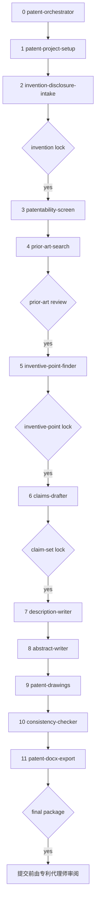

# patent-drafting-skills

[English](README.md) | 中文

一套面向智能体的技能，帮助科研人员和工程师把技术方案写成可以送审的**发明专利**草稿。三种模式：中国发明专利、美国实用专利非临时申请（utility non-provisional）、PCT 国际申请。

流程先访谈、再做客体筛查、再检索真实现有技术、锁定发明点，然后才撰写权利要求。后续技能负责权利要求书、说明书、摘要、附图、一致性核对和 Word 文本。本套件不代替你向任何受理机构提交申请。

作者：Xuzhen Li。许可证：MIT。

## 免责声明

本套件只提供起草辅助，不构成法律意见，也不形成代理关系。提交申请前，请由专利代理师或专利律师审阅全套文件。官费、表格和期限会变，以受理机构当时公布的文本为准。

不要用草稿隐瞒公开事实或最接近的对比文件。申请日前的公开可能破坏新颖性。在中国，发明人自己的论文通常会破坏新颖性：专利法第二十四条只是六个月的狭窄例外，不是普遍宽限期。在美国，35 U.S.C. § 102(b)(1) 是与发明人有关的一年宽限。PCT 本身不创设宽限期。

## 写给谁

写第一件发明专利的科研人员和工程师：手里有实验记录，还不习惯写权利要求。发明人始终是你。智能体只写你确认过的事实，缺口标成 `【待发明人确认】` 或 `[INVENTOR TO CONFIRM]`。

不适合外观设计、自由实施（freedom-to-operate）意见、诉讼，以及审查意见答复。实用新型只出现在中国客体筛查的建议里，不是另一条撰写流水线。

## 草稿怎么往下走

从 `patent-orchestrator` 进入。它读取 `patent.yaml`，把你送到第一个未完成的阶段。每完成一段，回到编排器。人类闸门在你明确同意之前会停住流水线。



`patentability-screen` 在客体被排除时可以停住流程。只有当你确认附图对理解发明并非必要时，才可以把 `drawings` 记为 `none` 并跳过 `patent-drawings`。单一性拆开时，先回到发明点技能，不写一套混在一起的权利要求。附图的视觉检查或校验和失败时，回到 `patent-drawings`。导出把附图嵌进 Word；校验和变了就停止。

## 技能

| # | 技能 | 做什么 | 主要产出 |
|---|------|--------|----------|
| 0 | `patent-orchestrator` | 进度、路由、闸门、管辖切换 | 状态报告 |
| 1 | `patent-project-setup` | 建立项目目录；已有草稿时只读复制并标出最早的真实缺口 | `patent.yaml`、`incoming/`、`intake_score.json` |
| 2 | `invention-disclosure-intake` | 访谈；每项特征和效果标注来源与证据等级；发明锁定 | `00-disclosure/disclosure.md`、`fact_ledger.md` |
| 3 | `patentability-screen` | 客体筛查（中国专利法第二条、第五条、第二十五条；美国 § 101）。中国案比较发明与实用新型 | `01-eligibility/screen.md` |
| 4 | `prior-art-search` | 真实数据库检索、特征矩阵，以及是否有单篇文献公开了全部必要特征 | `02-prior-art/search_log.md`、`feature_matrix.csv` |
| 5 | `inventive-point-finder` | 三步法或美国 § 103；按特定技术特征做单一性；不用未验证的效果 | `03-inventive-points/inventive_points.md` |
| 6 | `claims-drafter` | 先写引用关系草图再写权利要求；一项发明或经记载的组合；官费提醒，不设条数上限 | `04-claims/claims.md` |
| 7 | `description-writer` | 说明书、领域清单、背景自认检查、超出交底的句子、生物技术提醒 | `05-description/description.md` |
| 8 | `abstract-writer` | 中国摘要不超过 300 字，或美国摘要不超过 150 个单词 | `06-abstract/abstract.md` |
| 9 | `patent-drawings` | 先冻结零部件总表，正式图来自可编辑源，每张图一个 sha256 | `07-drawings/parts_master.json`、`sheet_manifest.json` |
| 10 | `consistency-checker` | 打开每一张图；检查黑白线条，以及每项关系画在哪一张图上 | `08-consistency/report.md` |
| 11 | `patent-docx-export` | Word 中嵌入附图；校验和变了就失败 | `09-package/*.docx` |

技能 0–5 把想法收到锁定的发明点。技能 6–11 把锁定结果写成申请文件。全套规格见 [docs/DESIGN.md](docs/DESIGN.md)。

## 安装

脚本把每个 `skills/<name>` 目录符号链接或复制到 `$HOME` 下的智能体技能目录。默认是 `link`。同一条命令再跑一次，已经正确的安装保持不变。`link` 模式不会覆盖目标位置上已有的真实目录。

| 目标 | 参数 | 目录 |
|------|------|------|
| Cursor | `--target cursor` | `$HOME/.cursor/skills` |
| Claude Code | `--target claude` | `$HOME/.claude/skills` |
| Codex | `--target codex` | `$HOME/.codex/skills` |
| 三者都装 | `--target all` | 上面三个路径 |

```bash
chmod +x install.sh
./install.sh --target cursor
./install.sh --target claude --mode copy
./install.sh --target all --dry-run
./install.sh -h
```

`--mode link`（默认）创建符号链接。`--mode copy` 复制文件，再次运行时只替换该技能目录里的内容。`--dry-run` 只打印动作，不写盘。

安装后新开一个智能体会话，技能才会被读到。`shared/` 留在本仓库，不会复制进智能体目录。每个技能的 `SKILL.md` 自带它需要的操作步骤。

## 快速开始

中国发明专利，对智能体说：

```
我要写一个发明专利
```

编排器会进入 `patent-project-setup`，管辖为 `CN`。你会得到中文技术交底书模板。随后是访谈。你说出 `发明人确认锁定交底` 之前，发明不会被锁定。

美国实用专利草稿：

```
start a US patent draft
```

同一条路径，管辖为 `US`，英文交底书、美国客体清单，以及按显而易见性而不是中国授权结论来写的工作表。

PCT：

```
起草一件PCT国际申请
```

英文国际申请草稿。请说明你已经在考虑的国家阶段（中国、美国，或两者）。智能体不会替你假定国家清单。

先准备一个本案目录。不要把尚未公开的数据贴进你不想保留的渠道。

## 项目目录

`patent-project-setup` 建立下面的树。后面的技能只写自己的文件夹。

```
<project>/
  patent.yaml
  00-disclosure/     空白交底书，然后是填好的交底书
  01-eligibility/
  02-prior-art/
  03-inventive-points/
  04-claims/
  05-description/
  06-abstract/
  07-drawings/
  08-consistency/
  09-package/
  incoming/          已有草稿的只读副本（有则建立）
  LOG.md
```

`patent.yaml` 记录名称、管辖、申请人、发明人、技术领域、公开情况、附图状态（`drawings`）和五道闸门。`LOG.md` 只追加、不改旧条目。

## 管辖模式

`jurisdiction` 取 `CN`、`US` 或 `PCT`。`CN` 的产出用中文，`US` 和 `PCT` 用英文。中途切换会重新打开闸门。智能体不会把已经锁定的中国权利要求自行译成美国权利要求。

| | CN | US | PCT |
|---|----|----|-----|
| 起草对象 | 发明专利 | 实用专利非临时申请 | 国际申请 |
| 权利要求 | 合适时用两部分，连接词为「其特征在于」 | 通常用 comprising；Jepson 两部分写法可选 | 合适时用两部分（PCT 细则第 6.3 条） |
| 说明书 | 技术领域、背景技术、发明内容、附图说明、具体实施方式 | 37 CFR 1.77 的各节 | PCT 细则第 5 条，包括发明人实际说明的最佳实施方式 |
| 摘要 | 正文不超过 300 个字，标点计入；有图时附一幅摘要附图 | 不超过 150 个单词（37 CFR 1.72(b)） | 英文以 50 至 150 个词为宜（PCT 细则第 8 条） |
| 宽限期 | 专利法第二十四条，四种情形，六个月（2020年修正）：国家出现紧急状态或者非常情况时为公共利益目的首次公开；中国政府主办或者承认的国际展览会；规定的学术会议或者技术会议；他人未经申请人同意泄露 | § 102(b)(1)，一年，且与发明人的公开有关 | 条约本身没有；国家阶段适用各国法律 |

文件构成、附图规则和官费入口见 [shared/jurisdictions.md](shared/jurisdictions.md)。

检索只用官方站点：
[中国专利检索](https://pss-system.cponline.cnipa.gov.cn)、
[Google Patents](https://patents.google.com)、
[Espacenet](https://worldwide.espacenet.com)、
[The Lens](https://www.lens.org)、
[PATENTSCOPE](https://patentscope.wipo.int)、
[USPTO Patent Public Search](https://ppubs.uspto.gov/pubwebapp/)。

官费：[cnipa.gov.cn](https://www.cnipa.gov.cn)、
[uspto.gov](https://www.uspto.gov)、
[patentscope.wipo.int](https://patentscope.wipo.int)。
技能里不写死金额。

## 原则

1. 不编造实验数据、技术效果或实施例。不知道就标出来。
2. 权利要求中的每一项特征都要能在说明书中找到依据（专利法第二十六条第四款；35 U.S.C. § 112(a)）。
3. 先引基础：后文的「所述 / the / said」必须先有「一种 / a」。
4. 说明书和附图中的附图标记一一对应。正式附图是可编辑源导出的 PNG，每张图有 sha256。导出嵌入这些字节，哈希变了就停止。
5. 现有技术必须是能够打开的真实文献，带公开号和链接。
6. 动笔前先问公开情况。中美 PCT 的宽限期不能互相替代。
7. 人类闸门：发明锁定、检索复核、发明点锁定、权利要求锁定、最终文本包。智能体不能自己合上闸门。最终闸门只表示草稿内部完整，提交前仍要由代理人审阅。

闸门用语和重新打开的规则见 [shared/gates.md](shared/gates.md)。
中英术语见 [shared/glossary_cn_en.md](shared/glossary_cn_en.md)。

## 仓库目录

```
patent-drafting-skills/
  README.md
  README.zh-CN.md
  LICENSE
  CHANGELOG.md
  install.sh
  docs/DESIGN.md
  shared/
    jurisdictions.md
    gates.md
    glossary_cn_en.md
  skills/
    patent-orchestrator/
    patent-project-setup/
    invention-disclosure-intake/
    patentability-screen/
    prior-art-search/
    inventive-point-finder/
    claims-drafter/
    description-writer/
    abstract-writer/
    patent-drawings/
    consistency-checker/
    patent-docx-export/
```

十二个技能都在这棵目录里。每个技能是一份 `SKILL.md`，需要时再加 `references/` 或 `scripts/`。`SKILL.md` 的操作说明用英文，中文法律术语在第一次出现时括注。`CN` 模板用中文，`US` 和 `PCT` 模板用英文。

## 许可证

MIT。Copyright (c) 2026 Xuzhen Li。见 [LICENSE](LICENSE)。
变更记录：[CHANGELOG.md](CHANGELOG.md)。
